# Application Control Flow Chart

This document outlines the routing, authentication guards, and navigation architecture for the **Citizen Health & Social Wellbeing Platform**.

## Control Flow Architecture

The platform uses a role-based access control (RBAC) model. The routing structure determines accessibility and page navigation dynamically based on the user's login session and account role.

```mermaid
graph TD
    %% Base Entry Point
    A["User Visits /"] --> B{"Is Authenticated?"}
    
    %% Auth Check Choices
    B -- No --> C["Redirect to /login"]
    B -- Yes --> D["RootRedirect Page"]

    %% Auth Flows
    C --> C1["Mobile OTP Login"]
    C --> C2["Password Login"]
    C --> C3["Forgot Password / Reset Flow"]
    C --> C4["Register Account"]
    
    C4 --> C5["Verify OTP"]
    C5 --> C
    C3 --> C

    %% Role Selection
    D --> E{"User Role Check"}
    E -- "Citizen" --> F["/dashboard (Citizen Dashboard)"]
    E -- "Doctor" --> G["/doctor/dashboard"]
    E -- "Ambassador" --> H["/ambassador/dashboard"]
    E -- "Researcher" --> I["/research/dashboard"]
    E -- "Admin" --> J["/admin/dashboard"]

    %% Citizen Flow
    subgraph Citizen Portal [Citizen Layout]
        F --> F1["Health Records (/phr)"]
        F --> F2["Analytics (/analytics)"]
        F --> F3["Risk Assessment (/risk-assessment)"]
        F --> F4["Telemedicine (/telemedicine)"]
        F --> F5["Mental Wellbeing (/mental-wellbeing)"]
        F --> F6["Community Forums (/community)"]
        F --> F7["Health Education (/education)"]
    end

    %% Doctor Flow
    subgraph Doctor Portal [Doctor Layout]
        G --> G1["Appointments (/doctor/appointments)"]
        G --> G2["Patients (/doctor/patients)"]
        G --> G3["Prescriptions (/doctor/prescriptions)"]
        G --> G4["Availability Settings (/doctor/availability)"]
    end

    %% Ambassador Flow
    subgraph Ambassador Portal [Ambassador Layout]
        H --> H1["Citizen Management (/ambassador/citizens)"]
        H --> H2["Screening Camps (/ambassador/camps)"]
        H --> H3["Health Surveys (/ambassador/surveys)"]
    end

    %% Researcher Flow
    subgraph Researcher Portal [Researcher Layout]
        I --> I1["Datasets (/research/datasets)"]
        I --> I2["Population Trends (/research/trends)"]
    end

    %% Admin Flow
    subgraph Admin Portal [Admin Layout]
        J --> J1["User Management (/admin/users)"]
        J --> J2["Doctor Approvals (/admin/doctors)"]
        J --> J3["Ambassador Approvals (/admin/ambassadors)"]
        J --> J4["CMS Content Manager (/admin/cms)"]
        J --> J5["System Settings / Audit Logs"]
    end

    %% Protected Route Guards
    style Citizen Portal fill:#e0f2f1,stroke:#00796b,stroke-width:1px
    style Doctor Portal fill:#e3f2fd,stroke:#1565c0,stroke-width:1px
    style Ambassador Portal fill:#f3e5f5,stroke:#7b1fa2,stroke-width:1px
    style Researcher Portal fill:#e8f5e9,stroke:#2e7d32,stroke-width:1px
    style Admin Portal fill:#ffebee,stroke:#c62828,stroke-width:1px
```

## Detailed Navigation Structure

### 1. Public Routes
*   **`/`**: Root route. Runs [RootRedirect](file:///c:/Users/Vasud/Downloads/citizen-health-platform/frontend/src/pages/RootRedirect.tsx) to identify the user's role and steer them to the correct dashboard.
*   **`/login`**: Standard login page supporting Email/Password and Mobile OTP login methods.
*   **`/register`**: Self-registration for citizens.
*   **`/verify-otp`**: Mandatory verification step for non-citizen roles (or when authenticating via OTP).
*   **`/forgot-password`** & **`/reset-password`**: Password recovery sequence.

### 2. Protected Layout Wrappers
Each portal group is wrapped by a `ProtectedRoute` component that validates:
1.  **Authentication**: Existence of a valid JWT token.
2.  **Authorization**: The user's role belongs to the route group's `allowedRoles` array.
3.  **Visual Layout**: If check passes, renders the specific layout template (`CitizenLayout`, `DoctorLayout`, etc.) complete with sidebars and navigation hooks configured from [navigationConfig.ts](file:///c:/Users/Vasud/Downloads/citizen-health-platform/frontend/src/config/navigationConfig.ts).
